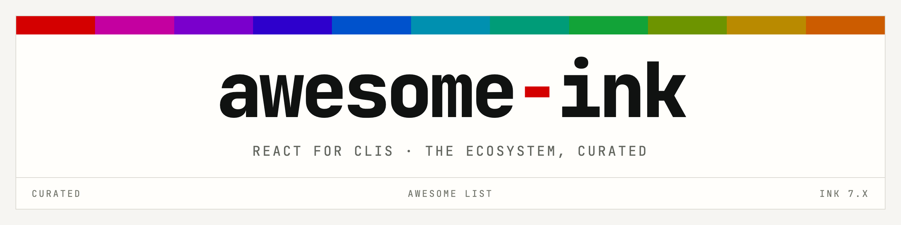

  <picture>
    <source media="(prefers-color-scheme: dark)" srcset="media/banner-dark.png">
    <source media="(prefers-color-scheme: light)" srcset="media/banner-light.png">
    
  </picture>

# Awesome Ink <!--  -->

> Build interactive command-line interfaces with React components.

[Ink](https://github.com/vadimdemedes/ink) is a React renderer that targets the terminal. It uses the [Yoga](https://github.com/facebook/yoga) flexbox engine, so layout is expressed with the same CSS-like properties used on the web.

## Contents

- [Awesome Ink ](#awesome-ink-)
  - [Contents](#contents)
  - [Getting Started](#getting-started)
  - [Frameworks](#frameworks)
  - [Component Libraries](#component-libraries)
  - [Input Components](#input-components)
  - [Display Components](#display-components)
  - [Layout Components](#layout-components)
  - [Feedback Components](#feedback-components)
  - [Hooks](#hooks)
  - [Utilities](#utilities)
  - [Testing](#testing)
  - [Applications](#applications)
  - [Games](#games)
  - [Underlying Libraries](#underlying-libraries)
  - [Footnotes](#footnotes)

## Getting Started

- [Ink](https://github.com/vadimdemedes/ink) - React renderer for command-line applications.
- [create-ink-app](https://github.com/vadimdemedes/create-ink-app) - Project scaffolder for JavaScript and TypeScript CLIs.
- [Routing recipe](https://github.com/vadimdemedes/ink/blob/master/recipes/routing.md) - Navigating between views with React Router's memory history.
- [Official examples](https://github.com/vadimdemedes/ink/tree/master/examples) - Runnable demonstrations of borders, focus, suspense, static output and subprocess rendering.

## Frameworks

- [Pastel](https://github.com/vadimdemedes/pastel) - File-system routed command framework with Zod-typed options and arguments.

## Component Libraries

- [Ink UI](https://github.com/vadimdemedes/ink-ui) - Themeable component set covering inputs, lists, spinners, badges and alerts.

## Input Components

- [ink-color-picker](https://github.com/sina-byn/ink-color-picker) - Interactive color selection.
- [ink-confirm-input](https://github.com/kevva/ink-confirm-input) - Yes/no prompt.
- [ink-form](https://github.com/lukasbach/ink-form) - Multi-field form with validation.
- [ink-multi-select](https://github.com/karaggeorge/ink-multi-select) - Multiple-choice list.
- [ink-quicksearch-input](https://github.com/Eximchain/ink-quicksearch-input) - Selection list with incremental search navigation.
- [ink-select-input](https://github.com/vadimdemedes/ink-select-input) - Single-choice dropdown.
- [ink-text-input](https://github.com/vadimdemedes/ink-text-input) - Single-line text field.

## Display Components

- [ink-ascii](https://github.com/hexrcs/ink-ascii) - Figlet-backed lettering with an expanded font selection.
- [ink-big-text](https://github.com/sindresorhus/ink-big-text) - Oversized banner lettering.
- [ink-chart](https://github.com/pppp606/ink-chart) - Sparklines and bar charts.
- [ink-color-pipe](https://github.com/LitoMore/ink-color-pipe) - Condensed string syntax for text styling.
- [ink-gradient](https://github.com/sindresorhus/ink-gradient) - Gradient-filled text.
- [ink-link](https://github.com/sindresorhus/ink-link) - Clickable hyperlinks in supporting terminals.
- [ink-markdown](https://github.com/cameronhunter/ink-markdown) - Markdown rendering with syntax highlighting.
- [ink-picture](https://github.com/endernoke/ink-picture) - Image rendering.
- [ink-syntax-highlight](https://github.com/vsashyn/ink-syntax-highlight) - Highlighted source code blocks.
- [ink-table](https://github.com/maticzav/ink-table) - Tabular data with column sizing.

## Layout Components

- [ink-divider](https://github.com/JureSotosek/ink-divider) - Horizontal rule with optional label.
- [ink-scroll-list](https://github.com/ByteLandTechnology/ink-scroll-list) - Scrollable list container.
- [ink-scroll-view](https://github.com/ByteLandTechnology/ink-scroll-view) - Scrollable viewport for overflowing content.
- [ink-stepper](https://github.com/archcorsair/ink-stepper) - Sequential wizard flow.
- [ink-tab](https://github.com/jdeniau/ink-tab) - Tabbed navigation.
- [ink-titled-box](https://github.com/mishieck/ink-titled-box) - Bordered container with a heading in the frame.
- [ink-virtual-list](https://github.com/archcorsair/ink-virtual-list) - Windowed list that renders only visible rows.

## Feedback Components

- [ink-progress-bar](https://github.com/brigand/ink-progress-bar) - Determinate progress display.
- [ink-spinner](https://github.com/vadimdemedes/ink-spinner) - Animated activity indicator.
- [ink-task-list](https://github.com/privatenumber/ink-task-list) - Grouped task states with per-task status.

## Hooks

- [ink-use-stdout-dimensions](https://github.com/cameronhunter/ink-monorepo/tree/master/packages/ink-use-stdout-dimensions) - Subscription to terminal width and height.

## Utilities

- [ink-spawn](https://github.com/kraenhansen/ink-spawn) - Child process management from within a component tree.

## Testing

- [ink-testing-library](https://github.com/vadimdemedes/ink-testing-library) - Frame capture and assertion helpers for component output.

## Applications

- [Atomic Agent](https://github.com/AtomicBot-ai/atomic-agent) - A local-first coding agent.
- [Autarky](https://github.com/pranshuchittora/autarky) - Reclaiming disk space from stale dependency directories.
- [Bit](https://github.com/teambit/bit) - Component distribution and collaboration platform.
- [Claude Code](https://github.com/anthropics/claude-code) - Agentic coding tool from Anthropic.
- [Gemini CLI](https://github.com/google-gemini/gemini-cli) - Agentic coding tool from Google.
- [GitHub Copilot CLI](https://github.com/features/copilot/cli) - Natural-language shell assistant.
- [Kubelive](https://github.com/ameerthehacker/kubelive) - Live view of Kubernetes cluster resources.
- [Shopify CLI](https://github.com/Shopify/cli) - Development tooling for apps, themes and storefronts.
- [Terraform CDK](https://github.com/hashicorp/terraform-cdk) - Infrastructure definition in general-purpose programming languages.
- [Wrangler](https://github.com/cloudflare/wrangler2) - Deployment tooling for Cloudflare Workers.
- [argonaut](https://github.com/darksworm/argonaut) - Argo CD resource management.
- [dev3000](https://github.com/vercel-labs/dev3000) - Agent orchestrator paired with a developer browser.
- [fast-cli](https://github.com/sindresorhus/fast-cli) - Network throughput measurement.
- [loki](https://github.com/oblador/loki) - Visual regression testing for Storybook.
- [srtd](https://github.com/t1mmen/srtd) - Live-reloading SQL templates for Supabase.
- [tap](https://node-tap.org) - Test-Anything-Protocol test runner.
- [tasuku](https://github.com/privatenumber/tasuku) - Minimal task runner.

## Games

- [Inkle](https://github.com/jrr/inkle) - Word guessing game.
- [Sea Trader](https://github.com/zyishai/sea-trader) - Taipan-inspired trading simulation.
- [Sudoku](https://github.com/mrozio13pl/sudoku-in-terminal) - Sudoku.
- [mnswpr](https://github.com/mordv/mnswpr) - Minesweeper.

## Underlying Libraries

- [chalk](https://github.com/chalk/chalk) - Terminal color and style application.
- [cli-boxes](https://github.com/sindresorhus/cli-boxes) - Box-drawing character sets used by border styles.
- [slice-ansi](https://github.com/chalk/slice-ansi) - Escape-aware string slicing.
- [string-width](https://github.com/sindresorhus/string-width) - Display width calculation for wide and emoji characters.
- [strip-ansi](https://github.com/chalk/strip-ansi) - Escape sequence removal.
- [Yoga](https://github.com/facebook/yoga) - Flexbox layout engine driving Ink's box model.

## Footnotes

Package inventory originally derived from the Ink readme at <https://github.com/vadimdemedes/ink>. It may have deviated over time.
